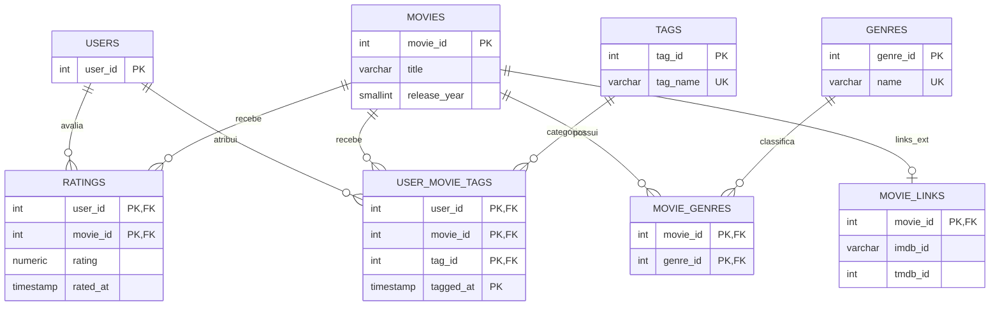

# Análise Comparativa: Banco de Dados Relacional (PostgreSQL) vs. Colunas Largas (Apache Cassandra)

**Dataset analisado:** MovieLens 20M (GroupLens Research)  
**Contexto:** estudo comparativo entre os paradigmas **Relacional (3FN)** e **NoSQL de colunas largas (wide-column)**.

---

## 1. Introdução e Contextualização do Problema

O objetivo deste estudo é modelar, implementar e confrontar duas abordagens de gerenciamento de dados sobre a mesma base pública: o dataset **MovieLens 20M**, com cadastro de filmes (`movie.csv`), links externos (`link.csv`), tags atribuídas por usuários (`tag.csv`) e **mais de 20 milhões de avaliações** (`rating.csv`).

As 20 milhões de avaliações são o centro da escolha do Cassandra como contraponto: é um volume grande, que só cresce (cada nota é uma inserção), e que é quase sempre lido por uma chave conhecida — "as avaliações deste usuário", "as avaliações deste filme". É exatamente o tipo de carga para o qual o Cassandra foi projetado.

1. **Paradigma Relacional**: modelagem **por entidades**. Os dados são normalizados (1FN a 3FN), sem redundância, com integridade garantida por chaves e transações ACID. Qualquer pergunta é respondida combinando tabelas com `JOIN`, `GROUP BY` e `ORDER BY`.
2. **Paradigma de colunas largas (Cassandra)**: modelagem **por consultas**. Parte-se da lista de perguntas e cria-se **uma tabela para cada uma**, com os dados duplicados e já ordenados no disco de forma que cada resposta seja a leitura de uma única partição. Não há `JOIN`, e agregações só funcionam dentro de uma partição. Em troca, o banco escala horizontalmente, sem nó mestre, e aceita escritas em altíssimo volume.

---

## 2. Modelagem e Estrutura de Dados

### 2.1. Abordagem Relacional (PostgreSQL - 3FN)

A base bruta foi normalizada da seguinte forma:

* **1ª Forma Normal (1FN)** — todo atributo deve ser atômico:
  * O atributo multivalorado `genres` (ex.: `"Action|Adventure|Sci-Fi"`) foi decomposto na tabela catálogo `genres` e na associativa $N:M$ `movie_genres`.
  * O título composto `"Toy Story (1995)"` foi separado em `title` e `release_year`.
* **2ª Forma Normal (2FN)** — nenhum atributo não-chave pode depender de **parte** de uma chave composta. Em `ratings`, a chave é `(user_id, movie_id)` e tanto `rating` quanto `rated_at` dependem do par completo (a nota é *de um usuário para um filme*). Não há dependência parcial: a tabela já está em 2FN. O mesmo vale para `movie_genres` e `user_movie_tags`.
* **3ª Forma Normal (3FN)** — nenhum atributo não-chave pode depender de outro atributo não-chave. Em `movies`, `title` e `release_year` dependem apenas de `movie_id`; em `movie_links`, `imdb_id` e `tmdb_id` também. Não há dependências transitivas no modelo.

Duas decisões **de projeto** (que vão além do exigido pela 3FN) merecem registro:

* **Catálogo de tags** (`tags` + `user_movie_tags`): o texto da tag não depende transitivamente de nada — ele é o próprio dado. Separá-lo num catálogo com chave substituta (`tag_id`) é uma escolha para **evitar repetir a mesma string** em centenas de milhares de linhas e padronizar a grafia (minúsculas, sem espaços nas pontas).
* **Links externos em tabela 1:1** (`movie_links`): também não é exigência da 3FN (os IDs dependem diretamente de `movie_id`). A separação isola metadados de fontes externas que nem todo filme possui (`tmdb_id` ausente em alguns casos).



> O diagrama editável está em [`der.drawio`](der.drawio) e o modelo lógico em [`modelo_logico.puml`](modelo_logico.puml).

* **Resultado relacional**: **8 tabelas**.

Para as consultas por usuário e por filme ordenadas por data (consultas 5 e 6), a tabela `ratings` tem os índices `(user_id, rated_at)` e `(movie_id, rated_at)`. Assim o PostgreSQL também responde a essas perguntas lendo o índice já na ordem certa — uma comparação justa com as tabelas do Cassandra, que são desenhadas para elas.

---

### 2.2. Abordagem em Colunas Largas (Cassandra)

No Cassandra, cada tabela tem uma **chave de partição** (define em qual nó e em qual bloco do disco a linha mora) e **colunas de ordenação** (*clustering columns*, que definem a ordem das linhas dentro da partição). Uma consulta eficiente lê **uma** partição, de preferência uma faixa contínua dela.

| Tabela | Chave de partição | Ordenação | Responde à |
| :--- | :--- | :--- | :--- |
| `movies` | `movie_id` | — | Consulta 1: ficha do filme (gêneros e tags como `set<text>` na própria linha) |
| `movie_stats` | `movie_id` | — | Consulta 1: total e soma das notas (contadores) |
| `top_movies` | `bucket` | `avg_rating DESC, vote_count DESC, movie_id` | Consulta 2: ranking pré-calculado |
| `genre_stats` | `genre` | — | Consulta 3: agregados por gênero pré-calculados |
| `movies_by_tag` | `tag` | `movie_id` | Consulta 4: filmes de uma tag |
| `ratings_by_user` | `user_id` | `rated_at DESC, movie_id` | Consulta 5: histórico do usuário |
| `ratings_by_movie` | `movie_id` | `rated_at DESC, user_id` | Consulta 6: avaliações do filme por período |

```sql
CREATE TABLE movielens.ratings_by_user (
    user_id  int,
    rated_at timestamp,
    movie_id int,
    rating   float,
    PRIMARY KEY ((user_id), rated_at, movie_id)
) WITH CLUSTERING ORDER BY (rated_at DESC, movie_id ASC);
```

Decisões de modelagem:

* **Desnormalização deliberada**: cada avaliação é gravada **duas vezes** (`ratings_by_user` e `ratings_by_movie`) e ainda soma nos contadores de `movie_stats`. O título do filme é repetido em `movies_by_tag` e `top_movies`. No relacional isso seria uma anomalia; no Cassandra é o modelo.
* **O que o banco não sabe agregar é calculado na carga**: o top 10 e as médias por gênero exigiriam `GROUP BY` sobre toda a base com `ORDER BY` pelo resultado, o que o Cassandra não permite. O script de carga calcula esses números e grava em `top_movies` e `genre_stats`. O custo: esses valores ficam desatualizados até a próxima recarga (ou exigem um processo à parte para mantê-los).
* **Contadores em meias estrelas**: colunas `counter` só aceitam inteiros. A soma das notas é guardada como `nota × 2` (`half_stars_sum`), e a média é calculada na aplicação.
* **Gêneros e tags como coleções** (`set<text>`) dentro da linha do filme, no lugar das tabelas associativas `movie_genres` e `user_movie_tags`.
* **Sem integridade referencial**: nada impede uma avaliação de um filme que não existe. Essa garantia passa para a aplicação.
* **Um único nó** (fator de replicação 1). Em produção, o padrão seria `NetworkTopologyStrategy` com 3 réplicas por data center.

* **Resultado Cassandra**: **7 tabelas**, cada uma servindo uma consulta.

---

## 3. Processo de ETL

1. **Extração** (`download_data.py`): baixa o `ml-20m.zip` e extrai os quatro CSVs.
2. **Transformação** (pandas, as mesmas regras para os dois bancos): título e ano separados, gêneros explodidos, tags normalizadas (sem espaços nas pontas, minúsculas), timestamp Unix convertido para data e hora, IMDb com zeros à esquerda.
3. **Carga**:
   * **PostgreSQL** (`load_relational.py`): `COPY` em lotes de 500 mil linhas, na ordem que respeita as chaves estrangeiras.
   * **Cassandra** (`load_cassandra.py`): escritas assíncronas e em paralelo pelo driver, agrupadas em lotes `UNLOGGED BATCH` **da mesma partição** (até 100 linhas). Lotes de uma partição só vão para um nó e são gravados de uma vez; lotes que misturam partições são um antipadrão no Cassandra. Ao final, a carga grava os contadores, o top 10 e os agregados por gênero.

Agrupar por partição deixou a carga **8 vezes mais rápida** do que gravar linha a linha (de ~2.200 para ~17.500 avaliações por segundo).

---

## 4. Confronto Direto de Consultas (SQL vs. CQL)

As consultas estão em [`relational/queries.sql`](../relational/queries.sql) e [`cassandra/queries.cql`](../cassandra/queries.cql).

### Consulta 1: Ficha completa de um filme

```sql
SELECT m.movie_id, m.title, m.release_year, l.imdb_id, l.tmdb_id,
       (SELECT string_agg(g.name, ', ' ORDER BY g.name)
          FROM movie_genres mg JOIN genres g ON g.genre_id = mg.genre_id
         WHERE mg.movie_id = m.movie_id) AS genres,
       r.total_ratings, r.avg_rating
FROM movies m
LEFT JOIN movie_links l ON l.movie_id = m.movie_id
CROSS JOIN LATERAL (
    SELECT COUNT(*) AS total_ratings, ROUND(AVG(rating), 2) AS avg_rating
      FROM ratings WHERE movie_id = m.movie_id
) r
WHERE m.movie_id = 1;
```

```sql
SELECT movie_id, title, release_year, imdb_id, tmdb_id, genres
FROM movielens.movies WHERE movie_id = 1;
SELECT half_stars_sum, rating_count
FROM movielens.movie_stats WHERE movie_id = 1;
```

* No PostgreSQL, a média é calculada na hora, lendo as dezenas de milhares de avaliações de Toy Story. No Cassandra são **duas leituras por chave**; a média vem dos contadores, mantidos a cada escrita.

### Consulta 2: Top 10 filmes (mínimo de 50 votos)

```sql
SELECT m.movie_id, m.title, m.release_year,
       COUNT(*) AS vote_count, ROUND(AVG(r.rating), 3) AS average_rating
FROM movies m
JOIN ratings r ON r.movie_id = m.movie_id
GROUP BY m.movie_id, m.title, m.release_year
HAVING COUNT(*) >= 50
ORDER BY AVG(r.rating) DESC, vote_count DESC, m.movie_id
LIMIT 10;
```

No Cassandra, essa consulta **não pode ser feita na hora**:

```sql
SELECT movie_id, avg(rating) FROM movielens.ratings_by_movie
GROUP BY movie_id ORDER BY avg(rating) DESC LIMIT 10;
-- erro de sintaxe: ORDER BY não aceita agregações, só colunas de ordenação

SELECT movie_id, avg(rating) FROM movielens.ratings_by_movie
GROUP BY movie_id ORDER BY rated_at DESC LIMIT 10;
-- InvalidRequest: ORDER BY is only supported when the partition key is restricted by an EQ or an IN.
```

O `ORDER BY` do CQL só ordena linhas **dentro de uma partição**, e só pelas colunas de ordenação. Não existe ordenar pelo resultado de uma agregação.

O que funciona é ler o ranking pré-calculado:

```sql
SELECT movie_id, title, release_year, vote_count, avg_rating
FROM movielens.top_movies WHERE bucket = 'all' LIMIT 10;
```

* É a consulta que melhor mostra o limite do Cassandra: ele não faz análise livre sobre a base. Toda pergunta de BI precisa ser prevista e pré-calculada.
* A partição única `bucket = 'all'` concentra a leitura num só nó (*hot partition*). Com milhares de linhas não é problema; em escala maior, o ranking seria dividido em vários buckets.

### Consulta 3: Filmes e média das avaliações por gênero

```sql
SELECT g.name AS genre, COUNT(DISTINCT mg.movie_id) AS total_movies,
       COUNT(r.rating) AS total_ratings, ROUND(AVG(r.rating), 2) AS avg_genre_rating
FROM genres g
JOIN movie_genres mg ON mg.genre_id = g.genre_id
LEFT JOIN ratings r  ON r.movie_id = mg.movie_id
GROUP BY g.genre_id, g.name
ORDER BY total_movies DESC, genre;
```

```sql
SELECT genre, total_movies, total_ratings, avg_rating
FROM movielens.genre_stats;   -- a aplicação ordena por total_movies
```

* Mesma situação da Consulta 2: o Cassandra só lê o resultado pronto. A ordenação fica com a aplicação, porque a tabela tem uma partição por gênero e não há ordenação entre partições.

### Consulta 4: Filmes marcados com `pixar` ou `animation`

```sql
SELECT m.movie_id, m.title, m.release_year, string_agg(DISTINCT t.tag_name, ', ') AS matched_tags
FROM movies m
JOIN user_movie_tags umt ON umt.movie_id = m.movie_id
JOIN tags t              ON t.tag_id = umt.tag_id
WHERE t.tag_name IN ('pixar', 'animation')
GROUP BY m.movie_id, m.title, m.release_year
ORDER BY m.movie_id LIMIT 20;
```

```sql
SELECT tag, movie_id, title, release_year
FROM movielens.movies_by_tag WHERE tag IN ('pixar', 'animation');
```

* O `IN` é permitido porque `tag` é a chave de partição: são lidas exatamente duas partições. O título está duplicado na tabela para evitar uma segunda leitura.

### Consulta 5: Histórico recente de um usuário

```sql
SELECT r.movie_id, r.rating, r.rated_at
FROM ratings r
WHERE r.user_id = 42
ORDER BY r.rated_at DESC, r.movie_id
LIMIT 20;
```

```sql
SELECT movie_id, rating, rated_at
FROM movielens.ratings_by_user WHERE user_id = 42 LIMIT 20;
```

* No Cassandra, as avaliações do usuário estão juntas no disco, já do mais recente para o mais antigo: a consulta lê as primeiras 20 linhas de uma partição e para.

### Consulta 6: Avaliações de Toy Story em janeiro de 2015

```sql
SELECT r.user_id, r.rating, r.rated_at
FROM ratings r
WHERE r.movie_id = 1
  AND r.rated_at >= '2015-01-01' AND r.rated_at < '2015-02-01'
ORDER BY r.rated_at DESC, r.user_id;
```

```sql
SELECT user_id, rating, rated_at
FROM movielens.ratings_by_movie
WHERE movie_id = 1
  AND rated_at >= '2015-01-01 00:00:00+0000'
  AND rated_at <  '2015-02-01 00:00:00+0000';
```

* Faixa contínua dentro da partição do filme. Filtrar por qualquer coluna que não seja da chave (por exemplo, `rating = 5`) é recusado ("Cannot execute this query as it might involve data filtering..."), a não ser com `ALLOW FILTERING`, que lê a partição inteira e é desaconselhado.

---

RESULTADOS_AQUI
